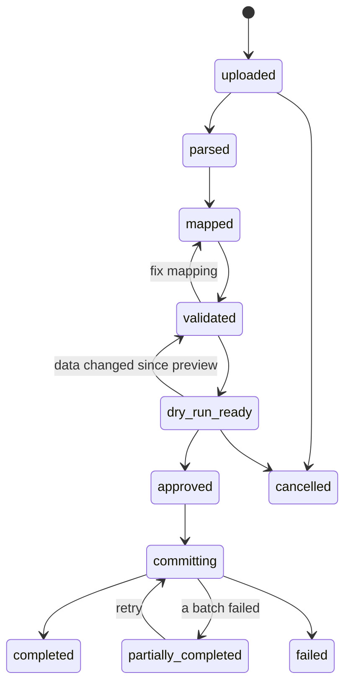
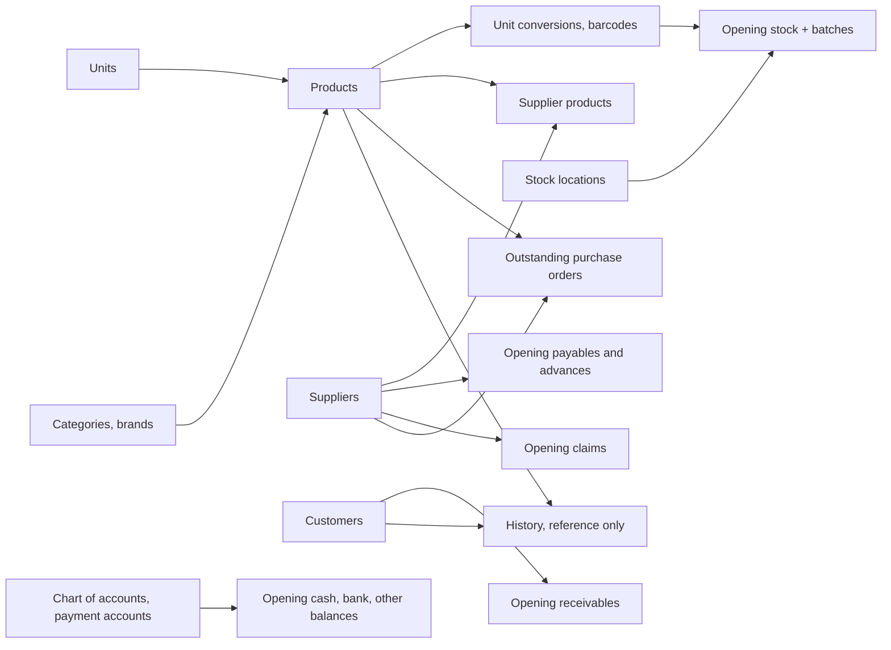

# Data import, migration and coexistence

Decisions: ADR-007 (staging, never direct) and ADR-010 (opening positions per domain). Nothing here exists today.

**Principles:** nothing reaches business tables unvalidated · nothing is silently overwritten · imported facts obey the same rules as typed ones · no history is invented · a dealership keeps its current process until it chooses to change.

---

# Part 1 — Import framework

## 1. Sources

| Source | Release | Note |
|---|---|---|
| CSV, XLSX | First | First-class; every entity has a downloadable template (English and Bangla headers) |
| Other software's CSV/XLSX exports | First | Through saved column mappings |
| TradeSphere exports | First | Round-trips by external id |
| Supplier catalog files | With discovery | Loads `supplier_products`, never products |
| Scheduled file import | Integration phase | Same pipeline, same approval rules |
| REST push and pull | Integration phase | Not assumed to exist on the dealer's side |
| Named ERP connectors | Optional, later | Only when a paying customer needs one |
| Paper registers and invoices | Manual | Typed into the templates; no OCR planned |

## 2. Data model

All tables are tenant-owned and follow `database-transformation.md` §1.

| Table | Key columns |
|---|---|
| `import_files` | original name, size, sha256, storage key or bytes, uploaded_by, purge_after |
| `import_jobs` | entity, source_system, file_id, status, mapping (jsonb), conflict_policy, cutover_date, control_totals (jsonb), dry_run_digest, row counts, created_by, approved_by, approved_at |
| `import_rows` | job_id, row_no, raw (jsonb), normalised (jsonb), status, errors (jsonb), action, target_type, target_id |
| `import_mappings` | name, entity, source_system, column map, value maps, date and number formats |
| `external_refs` | source_system, entity, external_id, internal_id, source_hash, last_synced_at; **unique (tenant_id, source_system, entity, external_id)** |

## 3. Job states

Parsing, validation, dry run and commit are background jobs.

## 4. Guided workflow

1. Choose entity (the wizard shows which prerequisites are missing).
2. Upload file or choose a connection.
3. Detect sheets, header row, encoding, delimiter.
4. Preview the first 50 rows.
5. Map columns; map values (for example `Pcs`, `PIECE` → `PCS`); choose date and number formats **explicitly** when ambiguous.
6. Validate required fields and types.
7. Match duplicates.
8. List missing references, with "import these first" or "create from this file" where allowed.
9. Resolve conflicts per row or by policy.
10. Dry run: counts of create, update, skip, reject; money and quantity totals; before and after for updates.
11. Approve and commit.
12. Report, with downloadable results.
13. Correct and re-import rejected rows only.

A saved mapping is offered automatically when headers match.

## 5. Validation

| Problem | Rule |
|---|---|
| Missing required value | Row rejected, column named |
| Number | Parsed to `Decimal`; thousands separators and Bangla digits `০-৯` converted; never through float; more decimals than the column allows is an error, not a rounding |
| Date | Only the chosen format; future dates rejected except expiry |
| Text | Trimmed and **Unicode-normalised (NFC)**, see `search-and-discovery.md` §2 |
| Duplicate SKU, barcode, supplier or customer code | Reported both within the file and against existing records |
| Barcode lost to Excel (`8.94E+12`) | Rejected with an explanation |
| Unit conversion | Factor > 1, one base unit, no change to a factor on a product that has movements |
| Missing product or party reference | Row blocked; never auto-created from a transaction file |
| Opening quantity | Positive; batch and expiry required when the product tracks them |
| Financial balances | Compared with declared control totals (§9) |
| Currency | Only the tenant currency; any other value rejected |
| Transaction status | Only mapped, known values |

The error report is the original columns plus `row`, `error` and `how to fix`. Cells beginning `=`, `+`, `-`, `@` or a tab are prefixed with an apostrophe to prevent formula injection.

## 6. Entities and order

| Entity | Match key (in order) | Updatable by import | Commits through |
|---|---|---|---|
| Units, categories, brands | external id, code or name | names | catalog service |
| Stock locations | the three fixed buckets; files only *refer* to them (branches and warehouses are not in the first release) | none | provisioning |
| Products | external id, SKU, barcode | names, category, brand, reorder level, active. **Prices only if the user ticks "update prices"** | catalog service |
| Unit conversions, barcodes | product + unit | barcode; factor only without movements | catalog service |
| Suppliers, customers | external id, code, phone + name (suggestion only) | contact fields. **Credit limit only if ticked** | parties service |
| Chart of accounts, payment accounts | code / name | names. Never type or party type of a used account | accounting service |
| Opening stock, receivables, payables, claims, cash | §8 | never updated | opening service |
| Outstanding purchase orders | external id | not updated once received against | purchasing service |
| History | external id | replaced only while unconfirmed | history store |

Goods receipts and other past transactions are **history** (§10), never replayed into stock.

## 7. Conflicts, idempotency, failure

**Policies:** *skip* (default) · *update permitted fields* · *create new* (only where the key allows) · *merge after confirmation* (row by row, field by field) · *reject*.

- Phone or name similarity only suggests a match; a person confirms it.
- **Idempotency:** `external_refs` plus the natural key; importing the same file twice creates nothing. A repeated file hash warns first.
- **Approval is bound to the preview:** `dry_run_digest` covers the rows and the current state of matched records. If they changed, the job returns to validation.
- **Master data** commits in batches of 500 rows, one transaction each, with row status written in the same transaction. Retry skips committed rows.
- **Opening loads are all-or-nothing:** one transaction, one journal.
- Partial success is allowed only for master data and is reported as such.

**Correction, not rollback**

| Imported | Correction |
|---|---|
| Master data with no use | Delete or deactivate from the job report |
| Master data already used | Edit or deactivate; never deleted |
| Opening load | Reverse, then load again; opening stock only while no later movement exists, otherwise a stock adjustment |
| Purchase orders | Cancel the unreceived quantity |
| Anything posted after import | Normal reversal rules (TS-03) |

---

# Part 2 — Migration and cutover

## 8. Opening positions per domain

Each tenant has a **cutover date**. Opening loads are dated the day before it, matching today's "before today" rule.

| Domain | One active line per | Journal (against Opening Balance Equity 3900, as today) |
|---|---|---|
| Stock | product, batch, location | Dr 1200 |
| Receivables | customer, reference | Dr 1100 |
| Payables and advances | supplier, reference | Cr 2000, or Dr for an advance |
| Company claims | supplier, reference | Dr 1300 |
| Cash, bank, mobile money | payment account | Dr account |
| Other balance-sheet accounts | account | As entered |

- Domains load and reverse independently; several loads per domain are allowed.
- A partial unique index over active lines stops the same item being opened twice.
- The "other accounts" domain **rejects** control accounts (1100, 1200, 1300, 2000 and any payment account), because their sub-domains already post them.
- Existing `opening_balances` rows are kept as legacy documents, untouched.

**Opening receivable items (invoice-level).** A dealer may supply open invoices (number, date, amount) so ageing and allocation work. These are stored as opening items, **not** as sales invoices. `receipt_allocations` gains `opening_item_id`, with exactly one of invoice or opening item set, and FIFO allocation includes them. This changes sales behaviour, so it is its own reviewed milestone with a written impact note (ADR-012). Without item detail, a single figure works as today.

**Outstanding purchase orders** import with *remaining* quantity only, marked as imported with the original number. No past receipts are created. An advance already paid is loaded in Payables; it shows on the supplier account but is not allocated to the order, because there is no payment document to allocate.

## 9. Reconciliation and sign-off

Before importing money or stock, the dealer enters **control totals** from their own system: stock quantity and value, total receivable, total payable, advances, claims, each cash and bank balance.

The cutover report shows declared, imported and difference, per domain and per party, plus `reconcile` results. Rule: every difference is zero or has a written reason. The owner signs off; TradeSphere then records the sign-off and sets the **period lock** to the day before cutover.

## 10. Preventing double counting

1. History is stored in `imported_documents` (type, date, number, party, lines, amounts). It posts **no journal and no stock movement**, is searchable, and is excluded from financial reports unless clearly shown as "imported history".
2. History import rejects dates on or after the cutover.
3. Live posting rejects dates before the cutover (the period lock).
4. So a past sale can appear in history and in an opening balance, but only the opening balance has any accounting effect.

The system never derives past movements or entries from history.

## 11. Parallel operation and coexistence

Each domain (catalog, parties, purchasing, stock, sales, receivables, accounting) has **one owner at a time** per tenant: *external* or *TradeSphere*.

| While a domain is external | TradeSphere does |
|---|---|
| Catalog, parties | Accepts imports and syncs; warns on manual edits |
| Stock | Stores **external stock snapshots** in their own table, shown as "as of <time> from <source>". They never enter the ledger or `stock_balances` |
| Balances | Same, as balance snapshots |
| Purchasing, sales | Optionally holds history records; posting screens are marked "not in use" |
| Accounting | Offers CSV export of TradeSphere journals for comparison or re-keying |

**Moving a domain to TradeSphere** is explicit: final import → reconciliation → sign-off → opening load from the final figures → ownership switch → external source set to read-only by agreement.

Typical path: catalog only → stock snapshots for visibility → purchasing and stock owned → sales owned → accounting owned.

Dependency rule: TradeSphere cannot own sales without owning stock, because posting a sale issues stock.

## 12. Integrations

| | Read-only sync (launch scope) | Two-way (not designed) |
|---|---|---|
| Direction | Source → TradeSphere | Both |
| Conflicts | Source wins for permitted fields; local edits flagged | Needs per-field ownership first |

- Tables `integration_connections` (type, encrypted credentials, schedule, owner domains) and `sync_runs` (started, finished, counts, errors, cursor).
- Every record keeps source system, external id, source hash and last sync time.
- Push API: tenant API keys, hashed, scoped, revocable, rate limited; gated by the `api_access` entitlement.
- **No integration posts stock or money** unless the owner enables that scope for that connection; each such call needs an `Idempotency-Key`. Default is staging for human approval.
- Health: last success, lag, consecutive failures, rejected rows; alert after 3 failures.
- Outbound pulls: HTTPS only, private and link-local addresses blocked after DNS resolution, redirects re-checked, size and time limits.

## 13. File safety

CSV and XLSX only · 10 MB and 50,000 rows per file to start · type checked by content · XLSX opened read-only with decompressed-size and ratio limits; formulas and macros never evaluated · parsing in the worker with a time limit · files stored per tenant, downloadable only through authorised endpoints, purged after 90 days. An XLSX reading library (for example `openpyxl` in read-only mode with `defusedxml`) is a new dependency to review when this phase starts.

## 14. Migration method

| Step | What happens | Who |
|---|---|---|
| Discovery | List systems, registers, spreadsheets, who maintains each | Dealer and onboarding staff |
| Ownership | Name the authoritative source per domain | Dealer |
| Mapping and cleansing | Templates, value maps, fix duplicates **in the source** | Both |
| Staging and dry run | Repeat until no unexplained errors | TradeSphere |
| Cutover date | Prefer a month start; stock counted that day | Dealer |
| Opening load and reconciliation | §8, §9 | Both, owner signs |
| Parallel run | 2–4 weeks; weekly comparison of stock and balances | Dealer |
| Incremental sync | Re-import changed master data by external id | Automatic or manual |
| Final cutover | Ownership switch | Owner |
| Recovery | Before live posting: reverse opening loads and repeat. After: keep TradeSphere as is and correct by documents; the dealer can return to the old process because it was never destroyed | Both |

### Scenario A — Excel for products, customers, suppliers, stock
Templates → import units, products, parties → stock count on cutover day → opening stock with batches → receivables and payables as figures or open items → cash → sign-off. The spreadsheet is kept as the archive. Accounting history stays out.

### Scenario B — Existing ERP or DMS with CSV/XLSX export
Save one mapping per export type → import master data with the ERP's ids as external ids → history as reference → run both for a month, re-importing master changes and comparing stock snapshots → opening loads from the ERP's closing reports → switch sales and stock → export journals if accounting stays in the ERP.

### Scenario C — System with an API
Read-only connection → initial pull into staging, approved once → scheduled sync of catalog, parties and stock snapshots → reconcile weekly → move one domain at a time. If the API cannot give ids or change timestamps, fall back to full file comparison by hash.

| | Automatic | Needs user confirmation | Needs accounting validation |
|---|---|---|---|
| New master data with unique keys | Yes, after approval of the batch | | |
| Possible duplicates, value mappings, price or credit updates | | Yes | |
| Opening stock value, receivables, payables, claims, cash, other accounts | | Yes | **Yes**, against control totals |
| History | Yes, reference only | | |

## 15. Tests and acceptance

- Each template round-trips; each validation rule has a failing fixture, including Bangla text and digits, BOM, formula cells, zip bombs and lost barcodes.
- Importing a file twice changes nothing.
- Killing the worker mid-commit and retrying gives the same result as one run.
- Opening loads reconcile to control totals; the same item cannot be opened twice.
- No import path creates a journal or movement for history.
- Tenant A cannot see tenant B's files, rows, mappings or references.
- **Phase accepted when** scenarios A, B and C are rehearsed end to end with zero unexplained differences.
