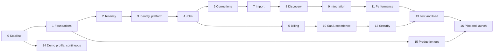

# Implementation roadmap

**Authoritative order of work for the implementer.** Read `architecture-decision-records.md` first. If a step proves wrong or unsafe, stop and report; do not redesign.

## Rules for every milestone

**Definition of Done:** code, migration with downgrade, tests, English and Bangla strings, regenerated API types, docs updated · all checks in `testing-and-acceptance.md` §8 that exist so far pass · completion report with commands, results and criteria marked passed, failed or not verified.

A field not listed for a phase means **none**. Dependencies are the prerequisites.

**One milestone = one branch and one reviewed pull request**, from `saas-transformation` (phase 0 from `main`). Never run a migration against production data without explicit authorisation.

**Default rollback** (unless a phase says otherwise): revert the pull request; `alembic downgrade` one revision on development and staging; production redeploys the previous image because schema changes are expand-then-contract.

**Environment note:** on the current Windows machine run Python in Docker; if `docker compose build` is refused by bake, use `docker build --target dev -t tradesphere-api ./backend` then `docker compose up -d --no-build`.

## Order

Differences from the brief's list: jobs are a phase of their own; financial corrections come before import; frontend work ships inside each phase, with phase 10 for the remaining journeys; production operations start early because TS-06 blocks any real data.

---

## Phase 0 — Stabilise (from `main`)

**Objective:** remove known defects and add gates. **Prerequisites:** none.

| Milestone | Tasks | Files |
|---|---|---|
| 0.1 Deadlock (TS-02) | Failing race test first; lock costs before journal posting in `reverse_invoice`; document the lock order; retry once on `40P01`/`40001`, then 409 | `sales/invoices.py`, `core/errors.py`, `core/db.py`, new `tests/test_reversal_concurrency.py` |
| 0.2 Proxy trust (TS-04) | `TRUSTED_PROXIES` setting; no `*` on public services | `start.sh`, `Dockerfile`, `config.py`, compose, `render.yaml` |
| 0.3 Sessions (TS-15, TS-18) | Grace only with a live successor; lock the period setting row | `auth/service.py`, `settings/service.py` |
| 0.4 CI gates (TS-17) | `alembic check`, downgrade round trip, API-type drift, dependency and secret scan | `.github/workflows/ci.yml` |
| 0.5 Errors and health (TS-07) | Error tracking behind a setting; `/api/live`, `/api/ready` | `core/observability.py`, `main.py` |

- **Database:** none. **Frontend:** error boundary and not-found page (TS-22).
- **Security:** closes TS-04, TS-15. **Deployment:** set trusted proxies per profile, then confirm real client IPs on Render.
- **Tests:** 1,000-iteration race; forged header; token after logout.
- **Accept:** no 500 or deadlock in the race; forged IP ignored; no token after logout; CI gates required.
- **Rollback:** revert; no data change.

**Status 2026-11-27:** implemented and checked locally on branches `p0/0.1-deadlock` to `p0/0.5-errors-health` (stacked, from `main`); **not pushed, merged or deployed**.

- Milestone 0.1 also fixed a second deadlock not in TS-02: a cash sale (journal number, then receipt number) against a standalone customer receipt (the reverse).
- Open: CI has not run on GitHub and is not a required check; real client addresses on Render are unconfirmed; error reporting has not been tried against a live tracker.
- Not covered by phase 0: the rest of TS-15 (lockout by a hostile client, general rate limit, MFA), alerting (TS-07, phase 15), frontend error reporting, image scanning, and the new TS-25.

## Phase 1 — Foundations

**Objective:** make isolation testable before building it. **Prerequisites:** 0.

| Milestone | Tasks |
|---|---|
| 1.1 Database roles | Idempotent provisioning script; owner and app roles; ownership transfer; append-only revokes; app refuses privileged role in production |
| 1.2 Test harness | App session as app role; maintenance connection for cleanup; controllable clock |
| 1.3 Boundaries (TS-21) | Move reconcile and opening above the modules they join; import contract in CI |
| 1.4 Text and time | NFC normalisation utility; pass a tenant-context object into date and numbering functions instead of reading settings |

- **Files:** `deploy/db/*`, `tests/conftest.py`, `shared/dates.py`, `shared/sequences.py`, `inventory/reconcile.py`, `accounting/opening.py`.
- **Migrations:** grants only. **Frontend:** none.
- **Security:** closes TS-05. **Deployment:** run provisioning once per existing database.
- **Tests:** role attributes, grants, whole suite as app role.
- **Accept:** suite passes as the app role; ledger `UPDATE` denied by grant and by trigger.
- **Rollback:** restore ownership with the script's reverse step.

**Status 2026-11-27:** implemented, branches `p1/1.1-db-roles` to `p1/1.4-text-and-time`. The text and business-date context is set per request through a context variable rather than a new parameter at every call site; date functions also accept it explicitly.

## Phase 2 — Tenancy and isolation

**Objective:** `database-transformation.md` implemented. **Prerequisites:** 1; a verified backup.

| Milestone | Content (migration step) |
|---|---|
| 2.1 | `tenants`, `tenant_memberships`, `auth_events`; default tenant if data exists (1) |
| 2.2 | Context: resolution, `after_begin` hook, ORM filter, CLI `--tenant` (2) |
| 2.3 | Split `seed` / `provision-tenant`; per-tenant timezone, fiscal year, currency (2, TS-12) |
| 2.4 | `tenant_id` by constant default, group by group; upsert targets and natural-key lookups (3) |
| 2.5 | Composite keys, tenant uniques, indexes, party generated columns (4) |
| 2.6 | Memberships and per-tenant roles backfill (5) |
| 2.7 | RLS, policies, grants, platform role (6) |
| 2.8 | Isolation suite and verification queries; before/after integrity totals (7) |

- **Files:** every model, `core/db.py`, `core/permissions.py`, `shared/*`, `seed.py`, `cli.py`, `tests/*`. **New:** `app/modules/tenancy/`.
- **Frontend:** none yet; one tenant behaves exactly as today.
- **Security:** the central control; second-person review of 2.5 and 2.7.
- **Deployment:** demo may be reset.
- **Tests:** `testing-and-acceptance.md` §4; existing suite unchanged in behaviour.
- **Accept:** verification queries return nothing; integrity totals identical; isolation suite green; creating a second tenant is blocked until then.
- **Rollback:** downgrade while one tenant exists; restore afterwards.

**Status 2026-11-27:** implemented, branches `p2/2.1-tenancy-tables` to `p2/2.8-isolation-suite`.

- Membership backfill moved from 2.6 to 2.1 (the context code needs it); 2.6 had nothing left to do.
- A second dealership is refused unless `ALLOW_MULTIPLE_TENANTS=true`. **Open:** the second-person review of the 2.5 and 2.7 migrations.
- `alembic check` does not compare the composite keys; `tests/test_schema_isolation.py` does instead.
- Not verified: the Render database role's attributes; the migration on a copy of real data (none exists).

## Phase 3 — Identity, membership, platform administration

**Objective:** people, dealerships and operators. **Prerequisites:** 2.

| Milestone | Content |
|---|---|
| 3.1 | Token claims, tenant switch, refresh naming the tab's tenant |
| 3.2 | Invitations, email verification, password recovery, reset restrictions (TS-09) |
| 3.3 | TOTP MFA, recovery codes, step-up, session list |
| 3.4 | Custom roles per tenant from the catalog |
| 3.5 | Platform operators, platform API and UI, audit |
| 3.6 | Support access grants, read-only |

- **Files:** `auth/*`, `users/*`, `permissions_catalog.py`; frontend `features/auth`, `features/users`, `api/client.ts`. **New:** `modules/platform/`, platform frontend bundle.
- **Migrations:** `tenant_invitations`, `user_tokens`, MFA, platform and grant tables.
- **Security:** `security-and-compliance.md` §3–4. Email goes through one sender interface (log-only in development); synchronous until phase 4.
- **Tests:** flows, role matrix, two tabs two tenants, operator without grant.
- **Accept:** MFA enforced; a shared user cannot be taken over; operator cannot read business tables.
- **Deployment:** `MFA` key and email settings. **Rollback:** feature flags for registration and invitations.

**Status 2026-11-27:** implemented, branches `p3/3.1-tenant-switch` to `p3/3.5-platform-operators` (3.5 and 3.6 in one commit).

- Not built: registration and its feature flag (phase 10); a screen for operators to browse records under a support grant (the API issues the read-only token); creating dealerships from the platform screen (command line only); QR code for enrolment (key and `otpauth:` link are shown); breached-password list beyond a short common-password list.
- Not verified: email through a real SMTP server; the new screens in a browser; Bangla wording.
- Still open from TS-15: a hostile client can lock out a known username; no general rate limit.

## Phase 4 — Jobs and outbox

**Objective:** reliable background work (ADR-006). **Prerequisites:** 2.

- **Milestones:** 4.1 `jobs`, claim with `SKIP LOCKED`, worker command, retries; 4.2 outbox and email delivery; 4.3 schedules, retention purges (TS-20), job health in platform UI.
- **Files:** compose (`worker`), `cli.py`. **New:** `modules/jobs/`.
- **Security:** worker sets context before any handler; no cross-tenant payloads.
- **Tests:** two workers never run one job; crash and retry; missing context fails.
- **Accept:** killing a worker loses no job and repeats no effect.
- **Deployment:** worker service; in-process thread on the demo. **Rollback:** stop the worker; jobs remain queued.

**Status 2026-11-27:** implemented, branch `p4/4.1-jobs` (4.1 to 4.3 in one commit). A handler's database work and its completion commit together; email can be sent twice if a worker dies between sending and committing. No alerting on job failures yet (phase 15). Audit and sign-in history are never purged (retention is a policy decision).

## Phase 5 — Subscriptions, entitlements, manual billing

**Objective:** `subscription-and-billing.md` §1–6. **Prerequisites:** 3, 4; **plan limits and prices from the business**.

- **Milestones:** 5.1 plans and entitlement service; 5.2 lifecycle and daily job; 5.3 read-only enforcement; 5.4 invoices and manual payments; 5.5 billing screens and platform billing; 5.6 *(later, separate approval)* first gateway adapter.
- **New:** `modules/billing/`, frontend billing and plan pages.
- **Migrations:** billing tables; existing tenants get a subscription.
- **Security:** only billing role writes payments; webhook rules §6.
- **Tests:** §10 of that document.
- **Accept:** full cycle demonstrated; route enumeration shows no write possible in read-only.
- **Deployment:** daily schedule. **Rollback:** an enforcement flag that turns all limits off.

## Phase 6 — Corrections and integrity

**Objective:** close TS-03, TS-14, TS-19, TS-24. **Prerequisites:** 4. Each reversal is a separate milestone with a written business-impact note (ADR-012).

| Milestone | Content |
|---|---|
| 6.1 | Reverse expense, fund transfer, owner transaction |
| 6.2 | Reverse commission and claim settlement; reopen rejected lines |
| 6.3 | Reverse sales return and purchase return, under the later-movement rule |
| 6.4 | Reconcile as SQL aggregation; add receivable, payable, claims, COGS checks; nightly job; endpoint returns the last result |
| 6.5 | Rebuild commands for stock projections |
| 6.6 | Rounding rule documented; change only if approved |

- **Files:** `finance/*`, `claims/*`, `sales/returns.py`, `purchasing/returns.py`, `inventory/reconcile.py`, `sales/rebuild.py`, matching screens.
- **Migrations:** status and reversal columns.
- **Security:** new reverse permissions.
- **Tests:** each reversal restores every balance; corrupted-data fixtures fail checks.
- **Accept:** every posted type correctable or documented; medium tenant reconciles in 60 s.
- **Rollback:** disable routes; posted reversals are never deleted.

## Phase 7 — Import and onboarding

**Objective:** `data-import-and-coexistence.md` parts 1 and 2. **Prerequisites:** 4, 6.

| Milestone | Content |
|---|---|
| 7.1 | Storage interface, files, jobs, staging, CSV, templates |
| 7.2 | XLSX, mapping and saved templates, validation, error report |
| 7.3 | Master data entities, conflict policies, `external_refs` |
| 7.4 | Opening loads per domain (ADR-010), control totals, sign-off, cutover lock |
| 7.5 | Outstanding purchase orders; history store |
| 7.6 | Opening receivable items and receipt allocation (changes sales behaviour: impact note and approval first) |
| 7.7 | Import wizard, history, onboarding checklist |

- **New:** `modules/imports/`, `features/imports/` (wizard, history, reconciliation and sign-off).
- **Migrations:** import tables, external refs, per-domain opening loads, history store.
- **Security:** §13; `imports:approve`.
- **Tests and accept:** §15; scenarios A and B rehearsed.
- **Deployment:** object storage on VPS; database storage on demo. **Rollback:** feature flag; correct data by §7 of that document.

## Phase 8 — Search and discovery

**Objective:** `search-and-discovery.md`. **Prerequisites:** 2 (7 for supplier files).

- **Frontend:** global search box, discovery dialog, supplier product review queue.
- **Milestones:** 8.1 NFC backfill and matching rules; 8.2 global search; 8.3 keyset lists; 8.4 supplier products and price history; 8.5 discovery flow; 8.6 *(optional, after legal review)* external provider.
- **New:** `modules/search/`. **Migrations:** supplier tables, indexes.
- **Security:** permission per result group.
- **Accept:** §9 budgets as the app role.
- **Rollback:** previous list search remains until replaced.

## Phase 9 — Integration and coexistence

**Objective:** §11–12 of the import document. **Prerequisites:** 7.

- **Milestones:** 9.1 domain ownership and snapshots; 9.2 scheduled file import; 9.3 API keys and push; 9.4 pull connector and health; 9.5 CSV exports of journals and stock.
- **New:** `modules/integrations/`; integration management, sync history and health screens.
- **Migrations:** connections, sync runs, snapshots, domain ownership, API keys.
- **Security:** scopes, SSRF controls, idempotency.
- **Accept:** scenario C rehearsed; no posting without explicit scope.
- **Rollback:** disable a connection; nothing else changes.

## Phase 10 — Remaining SaaS experience

**Objective:** complete the journeys no earlier phase owns. **Prerequisites:** 5, 7. Public landing page, registration and onboarding polish, tenant switcher, announcement and subscription banners, accessibility pass, responsive sale entry, forms moved to shared validation where touched (TS-22).
- **Migrations:** none. **Security:** registration limits and bot protection.
- **Tests:** Playwright journeys 1–3, 9, 11; accessibility checks. **Accept:** all pass in both languages.
- **Deployment:** static assets. **Rollback:** redeploy previous web image.

## Phase 11 — Performance

**Objective:** meet the budgets. **Prerequisites:** 8, 9. Data generator, staging server, `pg_stat_statements`, timeouts, query fixes, budgets (`performance-and-scalability.md`).
- **Migrations:** indexes, built concurrently. **Security:** synthetic data only.
- **Accept:** budgets met in all three scenarios. **Rollback:** drop an index or revert a query.

## Phase 12 — Security hardening

**Objective:** meet the security acceptance criteria. **Prerequisites:** 10. Headers and CSP, limits, upload and SSRF review, ASVS mapping, scans, independent test and fixes.
- **Accept:** `security-and-compliance.md` §11. **Rollback:** CSP back to report-only if it breaks a flow.

## Phase 13 — Test completion and load

**Objective:** prove behaviour under load and failure. **Prerequisites:** 11, 12. All Playwright journeys, soak test, failure injection (database restart, worker kill, full disk on staging).
- **Accept:** `testing-and-acceptance.md` gates; reconcile clean after soak.

## Phase 14 — Demo profile (continuous from phase 0)

**Objective:** a safe demonstration at all times. Keep Render working after every phase: demo flag and banner, in-process worker, seed of fictitious data, role check, reset rehearsal. **Accept:** `deployment-render-free.md` §11. **Rollback:** reset.

## Phase 15 — Production operations (start after phase 1)

**Objective:** an environment fit for real data.

| Milestone | Content |
|---|---|
| 15.1 | pgBackRest image, encrypted off-site archive, alerts, restore drill (TS-06) |
| 15.2 | Compose hardening, non-root, networks, secrets files, Caddy client IP (TS-16) |
| 15.3 | Registry, release and rollback scripts |
| 15.4 | Monitoring, alerts, runbook execution on an empty server |

- **Files:** `deploy/*`, Dockerfiles. **Accept:** `deployment-vps-production.md` §14. **Rollback:** keep the old stack definition until the drill passes.

## Phase 16 — Pilot and launch

**Objective:** evidence-based launch decision. **Prerequisites:** 13, 15, legal advice on data protection and retention.
Onboard one consenting dealership by the migration method, run in parallel for a full month including period close, weekly reconciliation with the dealer, fix findings, then decide against the launch criteria. **Rollback:** the dealer continues the old process, which was never removed.

---

## Faster route to a single-dealer pilot

If a pilot must precede the full service: phase 0 → 6.1–6.4 → 15 → 7.1–7.4 → pilot on an isolated server. Tenancy is still required before a second dealer shares an instance. This is an option for the business, not the default.

## Dependencies that could change the plan

| Dependency | If it fails |
|---|---|
| Plan limits and prices | Phase 5 cannot finish; build the mechanism with a test plan |
| Legal advice on data | Hosting region, deletion and retention may change |
| Render role capabilities | Demo uses single-role mode |
| Gateway merchant approval | Manual billing continues |
| Load results | A larger tier or a separate database earlier |
| Real data appearing before phase 2 | Rehearse the tenant migration on a copy; no reset |

## Deliberately not planned

Microservices, Kubernetes, Kafka, Redis, a search engine, trigram indexes, partitioning, branches and multi-warehouse, multi-currency, two-way synchronisation, OCR, a shared cross-tenant catalog, automatic card or wallet debit.
