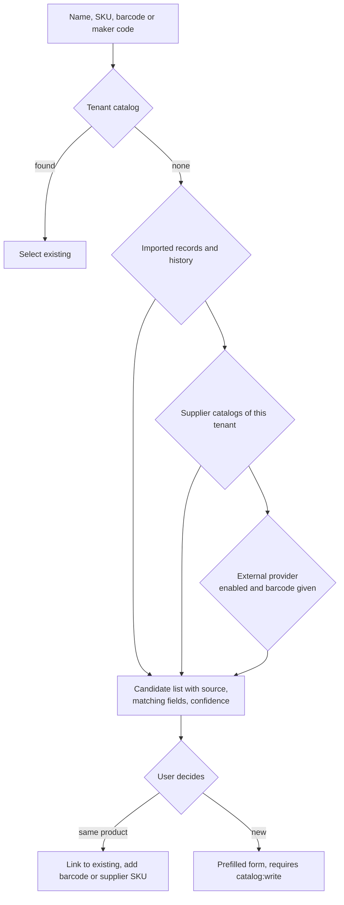

# Search and discovery

PostgreSQL only (ADR-008). Measurements are from 2026-11-27 on PostgreSQL 17 in Docker on a development laptop, with synthetic data.

## 1. What was measured

| Test | Result |
|---|---|
| Trigrams from Bangla words | Generated; similarity and `ILIKE` work |
| Full-text `simple` configuration on Bangla | Splits into correct words |
| Composed vs decomposed Bangla vowel (`U+09CB` vs `U+09C7 U+09BE`) | **Not equal** until normalised |
| Product `ILIKE`, 25,000 products, no RLS | 41 ms sequential scan; 0.8 ms with a trigram index |
| Same under **forced RLS** as the app role | **Trigram index not used**, even a composite `(tenant_id, name)` one. All tenant rows are read and filtered |
| Tenant with 25,000 products under RLS, partial match | 19 ms |
| Same tenant, fuzzy `word_similarity` ranking | 114 ms |
| Exact SKU under RLS | Index scan, 0.1 ms |

**Why:** with RLS, PostgreSQL applies the policy before any operator not marked *leakproof*. `ILIKE`, `LIKE` and similarity operators are not leakproof, so their indexes cannot be used first. Equality on text and integers is leakproof.

**Decision**
- Search stays fully under RLS. **No role bypasses RLS for search.**
- Rely on the `tenant_id` b-tree to narrow rows, then filter. This meets the budget at the target sizes.
- **Do not build trigram indexes now.** They would cost write time and not be used.
- Revisit only if a measured budget fails (for example above 100,000 products per tenant). The option then is a `SECURITY DEFINER` function, owned by a no-login role that can bypass RLS, which filters the tenant itself and returns **ids only**, with rows re-read under RLS. It needs its own security review, and a managed host may not allow it.

## 2. Text rules

- Normalise to **NFC** on every write and every query, in the API layer and in imports. A data migration normalises existing names (loop per tenant).
- Convert Bangla digits to Latin digits in numeric, code and barcode inputs.
- Escape `%` and `_` in user input (today they act as wildcards).
- Store `sku` and `barcode` trimmed; compare SKU case-insensitively.

## 3. Matching order

| Rank | Match | Method |
|---|---|---|
| 1 | Barcode (product or unit barcode) | equality |
| 2 | SKU, supplier SKU, document number | equality |
| 3 | Code or number prefix | prefix |
| 4 | All words present, any order, English or Bangla | `ILIKE` per word |
| 5 | Fuzzy | `word_similarity`, **only if ranks 1–4 return nothing**, query of 3+ characters |

Ties break by active first, then recently sold, then name.

## 4. Search surfaces

- **Entity lists** (existing pages): same matching, with filters, sorting and pagination.
- **Global search:** `GET /api/v1/search?q=` returns up to 5 hits per group. Each group runs only if the user has its read permission; cost and profit fields follow `reports:profit`.

| Group | Fields | Permission |
|---|---|---|
| Products, batches | SKU, barcode, names, batch number | `catalog:read` |
| Categories, brands | names | `catalog:read` |
| Customers | code, name, shop, phone | `customers:read` |
| Suppliers | code, name, phone | `suppliers:read` |
| Purchase orders, receipts | number, challan, supplier | `purchasing:read` |
| Invoices, returns, receipts | number, customer | `sales:read` |
| Supplier payments | number, reference | `purchasing:pay` |
| Accounts | code, name | `finance:read` |
| Imported history | number, party | permission of its type |

Debounce 300 ms, minimum 2 characters (1 for a scanned barcode), cancel stale requests.

**Pagination:** keyset on `(business_date, id)` for invoices, movements, journal and audit lists. Measured at 200,000 invoices: offset 150,000 took 271 ms, keyset 4 ms. Replace exact total counts on large lists with "more results".

## 5. Stock and order questions

| Question | Source | Index (tenant-prefixed) |
|---|---|---|
| Available stock, by location, by batch | `stock_balances` | product, location |
| Expiring | `batches` + balances | `(tenant_id, expiry_date)` |
| Low stock | `product_costs` vs `reorder_level` | scan per tenant; measure |
| Movement history | `inventory_movements` | `(product_id, id)` (exists) |
| Open and part-received orders | `purchase_orders` + items | `(tenant_id, supplier_id, status)` |
| Supplier delivery history | `goods_receipts` | `(tenant_id, supplier_id, business_date)` |
| Customer order history | `sales_invoices` | `(tenant_id, customer_id, business_date)` |

`date` and `bigint` comparisons are expected to remain index-usable under RLS; confirm with `EXPLAIN` **as the app role** in the tenancy phase. All plan checks must run as that role.

## 6. Finding a product that is not there

**Never create or link without a person's confirmation.** Confidence: *exact* (GTIN or mapped supplier SKU), *likely* (maker code and brand), *possible* (name similarity). Each candidate shows its source and retrieval date.

## 7. Barcodes and external data

- Validate GTIN-8/12/13/14 check digits; compare as 14-digit zero-padded. Internal codes that fail the check are still allowed.

| Provider | Facts checked 2026-11-27 | Position |
|---|---|---|
| [Open Food Facts](https://openfoodfacts.github.io/documentation/docs/Product-Opener/api/) | Database ODbL 1.0, contents DbCL, images CC BY-SA 3.0. Limits: 15 product reads and 10 searches per minute **per IP**; a custom User-Agent is required; bans possible | Optional, off by default, food only. Coverage of Bangladeshi products not tested |
| [Verified by GS1](https://www.gs1.org/services/verified-by-gs1) | API access is through a GS1 member organisation | Contact GS1 Bangladesh. Terms and price **not verified** |
| Paid barcode APIs | Not researched | Evaluate only if the two above are insufficient |

Rules for any provider:
- Adapter interface; server-side only; **send only the barcode**, no tenant or user details.
- Cache per barcode, respect limits (one server IP serves all tenants), time out in 3 s, fail quietly.
- Because of share-alike terms, do **not** blend provider data into a shared cross-tenant catalog. Copy only fields the user accepts, recording the source. Do not copy images at launch. Get legal review before enabling.
- External data **never** sets dealer price, trade price, MRP, cost, supplier or stock.

There is no cross-tenant product catalog: one dealer's catalog is confidential.

## 8. Supplier catalogs and procurement

`supplier_products`: supplier_id, supplier_sku, supplier_description, product_id (null until mapped), uom_id, pack_factor, price, min_order_qty, valid_from, source, last_seen_at. Unique `(tenant_id, supplier_id, supplier_sku)`.
`supplier_price_history`: append-only, one row per price change.

- Imported by file; unmapped rows form a review queue.
- A purchase order offers the supplier SKU and last price as a **suggestion**; the user confirms the price.
- One product may have several suppliers with different codes and prices.
- New supplier: search existing suppliers by phone and similar name to avoid duplicates. Appearing in any file or external source says nothing about legitimacy; TradeSphere makes no such claim.

## 9. Tests and acceptance

- Relevance fixtures in English and Bangla, including decomposed input and Bangla digits.
- No result from another tenant (isolation suite) or without permission.
- p95 under 300 ms for global search on the medium dataset **as the app role**.
- Discovery never writes without confirmation; provider off by default; provider outage does not affect search.
