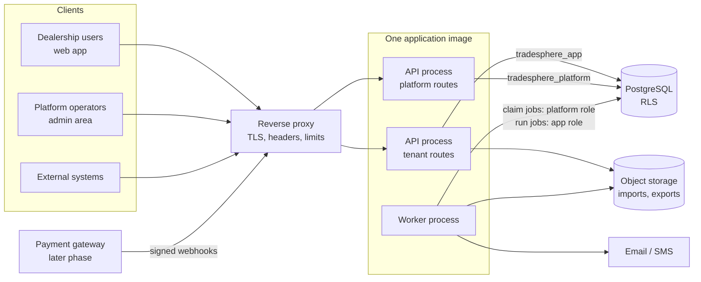
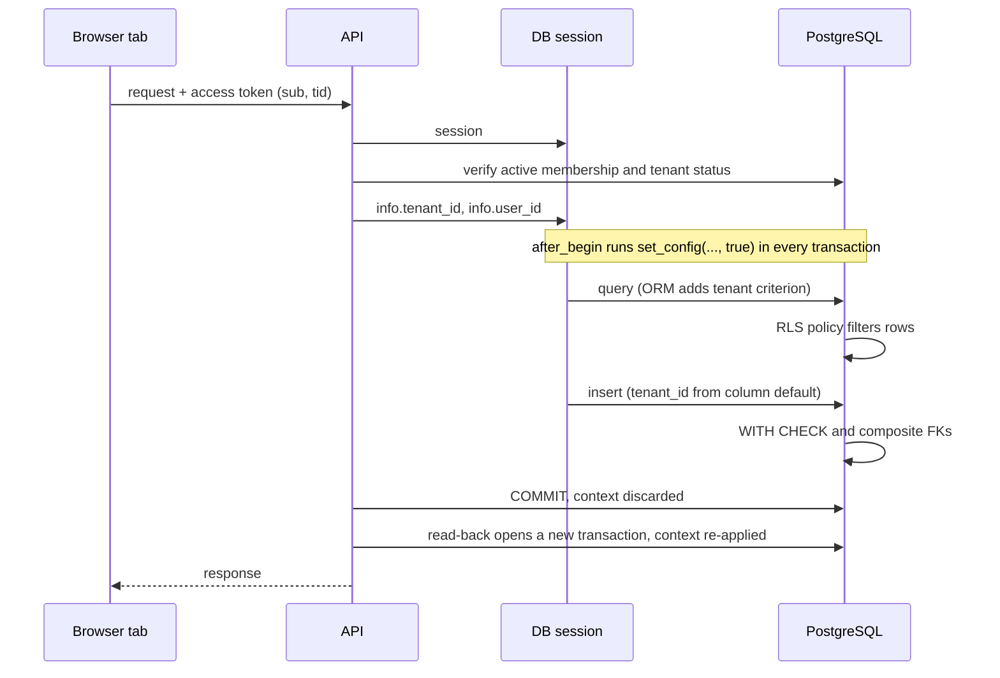
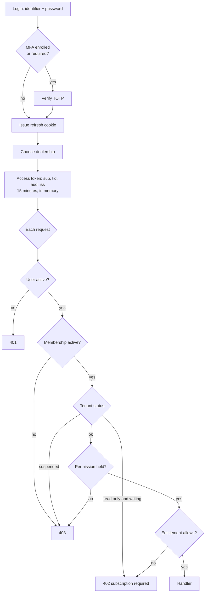
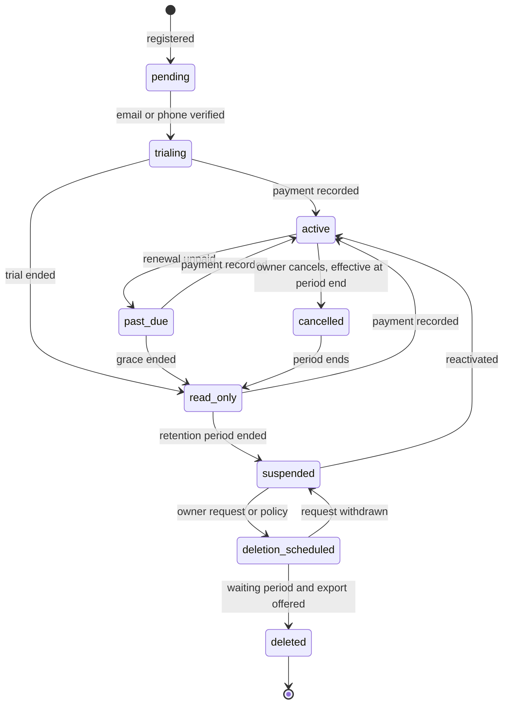
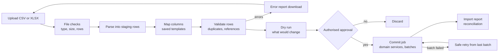
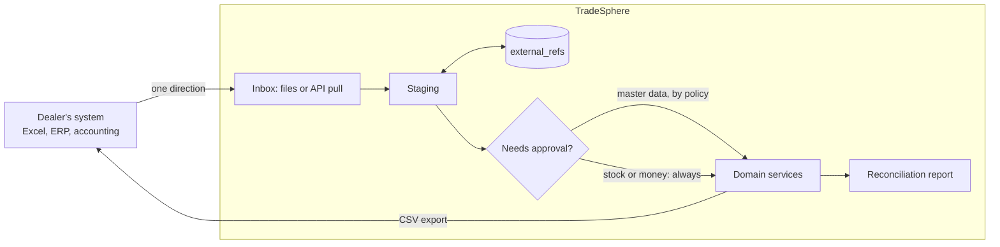
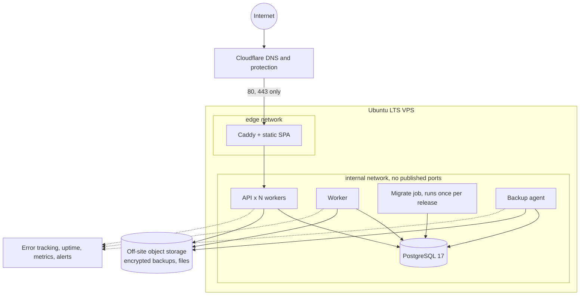

# Target architecture

A modular monolith serving many independent dealerships from one database with database-enforced isolation. Rationale is in `architecture-decision-records.md`; the schema is in `database-transformation.md`.

## 1. Modules

| Module | Owns | Status |
|---|---|---|
| `core` | Config, database session and tenant context, security, errors, logging | Extend |
| `shared` | Money, dates, numbering, idempotency, audit, pagination | Extend |
| `tenancy` | Tenants, memberships, invitations, provisioning, tenant settings | New |
| `auth`, `users` | Login, sessions, MFA, recovery, per-tenant roles | Extend |
| `platform` | Operators, support grants, platform audit, platform admin API | New |
| `billing` | Plans, subscriptions, entitlements, billing records, payment providers | New |
| `jobs` | Queue, outbox, worker, schedules | New |
| `catalog`, `parties`, `inventory`, `purchasing`, `sales`, `claims`, `accounting`, `finance`, `settings`, `audit` | The existing business domains | Keep |
| `imports` | Staging, mapping, validation, commit, reports | New |
| `integrations` | External references, connections, sync runs | New |
| `search` | Search endpoints and product discovery | New |

**Dependency direction** (enforced in CI): `core/shared` ← `tenancy/auth` ← business domains ← `imports/integrations/search`. `billing` exposes only the entitlement check to business domains. `platform` never imports business domains. Reconciliation and opening balances move above the domains they combine, removing today's two cycles.

**Conventions kept:** services never commit; one transaction per operation; routes declare permissions; money is `Decimal`; the server computes totals.

## 2. SaaS platform

Tenant and platform routes live in the same service but use different dependencies and database connections.

## 3. Tenant isolation

**Rules for every path that is not an ordinary request:**

| Path | Rule |
|---|---|
| Jobs | Payload carries `tenant_id`; the worker sets context before calling any service |
| Imports and exports | Files are keyed `tenant/{id}/…`; downloads go through an authorised endpoint, never a public URL |
| Reports and search | Run on the same session, so RLS applies |
| Caches | None server-side today. Any future cache key starts with the tenant id. The frontend clears its query cache on tenant switch |
| Logs | Tenant id and user id in context; no amounts or personal data |
| Idempotency | Keys are unique per tenant and user |
| CLI | Commands take `--tenant` or `--all-tenants`; none runs without a context |

## 4. Authentication and authorisation

Order matters: identity, membership, tenant status, permission, entitlement, then business rules.

## 5. Subscription lifecycle

Registration creates the account and tenant; it does not require payment. **Subscription status** (billing) is separate from **tenant status** (operator action, for example abuse), and the stricter one applies. Durations are open decisions in `executive-assessment.md`.

## 6. Import pipeline

Master data may be corrected by a further import. Anything that posts stock or money is corrected only by reversal, subject to the rules in TS-03.

## 7. External integration

Launch scope is **read-only synchronisation into TradeSphere** plus exports. Each data domain has one owning system per tenant at any time. Two-way synchronisation is out of scope until conflict ownership is designed. No integration posts stock or money without explicit authorisation and idempotency keys.

## 8. Production infrastructure

Migrations run as a single release step before new application containers start, never from API workers. Running several API instances is safe because sessions, locks, idempotency and numbering all live in PostgreSQL; the login limiter already does. Sizing and runbooks: `deployment-vps-production.md`. The separate demo profile: `deployment-render-free.md`.

## 9. Frontend

Keep React 19, Vite, TanStack Router and Query, and the generated client.

| Area | Change |
|---|---|
| Auth state | Add current tenant and membership list; refresh names the tab's tenant; switching clears the query cache |
| Routes | Public (landing, register, verify, reset, accept invite), onboarding, dealership app, platform admin as a separately loaded bundle |
| New screens | Tenant switcher, invitations, billing, import wizard and history, reconciliation, integrations, global search, product discovery |
| Resilience | Error boundary, not-found page, subscription-state banners, read-only mode |
| Quality | Component and Playwright tests; English and Bangla for every new string |
