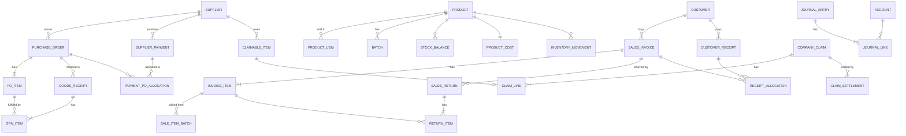

# TradeSphere — Master Specification

> Dealership Inventory, Sales, Purchasing, Claims & Accounts system for an FMCG dealership in Bangladesh.
> Stack: FastAPI + SQLAlchemy 2 + PostgreSQL · React + TypeScript + Tailwind CSS.
> This document is the authoritative spec. Code that disagrees with it is a bug, unless this document is updated first.

---

## 0. Business summary

The dealer buys goods from a **company** (the supplier/manufacturer) and sells them to **retailers** (customers).

| Real-world fact | System consequence |
|---|---|
| Dealer pays the company **up front** for a purchase order (PO) | Payment and PO are separate documents. The payment sits as a **supplier advance** until goods arrive |
| Company ships a PO in **several partial shipments**, and new POs overlap old ones | Each shipment is a separate **Goods Receipt (GRN)** linked to PO lines. Each PO keeps its own ordered / received / outstanding figures |
| Dealer sells for **cash or on credit** (partial payments common) | An invoice and the money received are separate. Customer dues come from the ledger, never typed in |
| Customers **return** goods (good or damaged) | A return is its own document linked to the original invoice line. It reverses revenue and the original cost |
| Dealer gives **commission / trade offers / free goods** that the **company reimburses later** | Each one creates a **claimable item**. Items are grouped into a **company claim**. The company settles in cash **or** by credit against the supplier account |
| FMCG goods have **batches and expiry dates** and are bought in **cartons**, sold in cartons or pieces | Batch + expiry per stock line, FEFO picking, unit conversions per product |

### Design principles (non-negotiable)

1. **Each business event is its own document**: PO ≠ supplier payment ≠ GRN ≠ invoice ≠ receipt ≠ return ≠ claim ≠ settlement.
2. **Ledgers are the source of truth.** `inventory_movements` (stock) and `journal_lines` (money) are append-only. Balance tables (`stock_balances`, `product_costs`, `daily_sales_summary`) are projections, updated **in the same DB transaction** and rebuildable by command.
3. **Posted documents are never edited or deleted.** Corrections happen by reversal plus a new document.
4. **Money is `Decimal`/`NUMERIC`** end to end, serialised over the API as **strings**. The server computes every authoritative total.
5. **Every posting is atomic.** It validates, locks, writes the document, movements, journal and projections, then commits, or rolls back entirely.
6. **Modular monolith.** One FastAPI app with one Postgres database, split into domain modules. No microservices, no Kafka, no Kubernetes.

---

## 1. Domain glossary

| Term | Meaning |
|---|---|
| **DP** — Dealer/Distributor Price | Price the dealer pays the company per base unit |
| **TP** — Trade Price | Default price the dealer charges retailers |
| **MRP** | Maximum retail price printed on the pack (informational, and a ceiling check) |
| **Base unit** | Smallest unit (piece/pack/kg). **All quantities are stored in base units** |
| **UoM conversion** | e.g. `1 CTN = 24 PCS`, `1 BOX = 12 PCS`. The UI accepts "5 ctn + 3 pcs" and stores 123 |
| **Batch** | Manufacturer lot with optional mfg date and expiry date |
| **FEFO** | First-Expiry-First-Out: sales consume the batch with the earliest expiry first |
| **Location** | Logical stock bucket: `SELLABLE`, `DAMAGED`, `EXPIRED` (extensible to warehouses/branches) |
| **WAC** | Moving Weighted Average Cost per product, used for COGS |
| **Claimable item** | Money the company owes the dealer for one event (commission, trade discount, free goods, damage…) |
| **Claim** | A batch of claimable items submitted to the company |
| **Settlement** | Company's response to a claim: cash/bank received, or credit to the supplier account, or rejection |
| **Business date** | Calendar date in `Asia/Dhaka` that a document belongs to. Drives all reports |
| **Fiscal year** | Bangladesh FY: **1 July – 30 June**. FY 2025-26 is coded `2526` |
| **Document lifecycle** | `draft → posted → reversed`. Only drafts may be edited or deleted |

---

## 2. Data model

Conventions:
- PK `id BIGINT GENERATED ALWAYS AS IDENTITY`. Every table has `created_at TIMESTAMPTZ`, `updated_at TIMESTAMPTZ`, and `created_by` (user id) where it makes sense.
- Money `NUMERIC(18,2)`, quantity `NUMERIC(18,3)`, unit cost / avg cost `NUMERIC(18,4)`.
- Timestamps are UTC (`timestamptz`), and documents also carry `business_date DATE` (Asia/Dhaka).
- Document headers carry `doc_no` (unique, gapless per type per FY), `status`, `business_date`, `notes`, `posted_at`, `posted_by`, `reversed_by_id`, `reversal_of_id`.
- Enums are stored as `VARCHAR` with `CHECK` constraints, so they are easy to evolve.

### 2.1 Control / identity

| Table | Key columns | Constraints |
|---|---|---|
| `users` | username, full_name, phone, password_hash, is_active, last_login_at | username unique (case-insensitive) |
| `roles` | code (`owner`,`manager`,`cashier`,`storekeeper`), name | code unique |
| `permissions` | code (e.g. `products:write`), description | code unique |
| `role_permissions` | role_id, permission_id | PK(role_id, permission_id) |
| `user_roles` | user_id, role_id | PK(user_id, role_id) |
| `refresh_tokens` | user_id, token_hash, expires_at, revoked_at, replaced_by_id, user_agent, ip | token_hash unique |
| `audit_logs` | occurred_at, actor_id, action, entity_type, entity_id, before JSONB, after JSONB, ip, request_id | append-only (no UPDATE/DELETE grants in prod) |
| `document_sequences` | doc_type, fiscal_year, next_value | PK(doc_type, fiscal_year). Row-locked `FOR UPDATE` → gapless |
| `idempotency_keys` | key, user_id, endpoint, request_hash, response_status, response_body JSONB, created_at | unique(user_id, key) |
| `app_settings` | key, value JSONB | e.g. `business_profile`, `period_lock_date`, `allow_sell_below_dp` |

### 2.2 Catalog

| Table | Key columns | Constraints |
|---|---|---|
| `categories` | name_en, name_bn, parent_id, is_active | unique(name_en) |
| `brands` | name_en, name_bn, is_active | unique(name_en) |
| `uoms` | code (`PCS`,`CTN`,`BOX`,`KG`…), name_en, name_bn | code unique |
| `products` | sku, barcode, name_en, name_bn, category_id, brand_id, base_uom_id, **dp, tp, mrp**, reorder_level (base qty), track_batch, track_expiry, is_active | sku unique; barcode unique when not null; dp,tp,mrp ≥ 0 |
| `product_uoms` | product_id, uom_id, factor_to_base, is_purchase_default, is_sales_default, barcode | unique(product_id, uom_id); factor_to_base > 0; the base unit is implicit (factor 1) |
| `batches` | product_id, batch_no, mfg_date, expiry_date | unique(product_id, batch_no) |

### 2.3 Inventory

| Table | Key columns | Constraints |
|---|---|---|
| `locations` | code (`SELLABLE`,`DAMAGED`,`EXPIRED`), name, is_sellable | code unique |
| `inventory_movements` | business_date, product_id, batch_id NULL, location_id, **qty_base** (signed), unit_cost, value (signed), movement_type, source_doc_type, source_doc_id, source_line_id, reversal_of_id | append-only; qty ≠ 0; indexes (product_id, business_date), (source_doc_type, source_doc_id) |
| `stock_balances` | product_id, batch_id NULL, location_id, qty_base | unique(product_id, batch_id, location_id) NULLS NOT DISTINCT; **CHECK qty_base ≥ 0** |
| `product_costs` | product_id PK, qty_on_hand, total_value, avg_cost | qty_on_hand ≥ 0 |
| `stock_adjustments` / `_items` | reason (`count`,`damage`,`expiry`,`found`,`other`), product, batch, location, qty_delta | doc lifecycle |
| `stock_transfers` / `_items` | from_location, to_location, product, batch, qty | e.g. SELLABLE → EXPIRED |

`movement_type` ∈ `opening`, `grn`, `grn_free`, `sale`, `sale_free`, `sales_return`, `purchase_return`, `adjustment`, `transfer_in`, `transfer_out`, `claim_out`, `write_off`, `reversal`.

### 2.4 Purchasing

| Table | Key columns | Constraints |
|---|---|---|
| `suppliers` | code, name, phone, address, contact_person, is_active | code unique |
| `purchase_orders` | doc_no, supplier_id, business_date, expected_date, status, total_value | status ∈ `draft`,`confirmed`,`partially_received`,`received`,`closed_short`,`cancelled` |
| `purchase_order_items` | po_id, product_id, uom_id, factor, ordered_qty_base, free_qty_base, unit_cost (per base), line_value, received_qty_base, received_free_qty_base, cancelled_qty_base | received + cancelled ≤ ordered (CHECK) |
| `goods_receipts` | doc_no, po_id, supplier_id, business_date, challan_no, vehicle_no, status | doc lifecycle |
| `goods_receipt_items` | grn_id, po_item_id, product_id, batch_id, received_qty_base, free_qty_base, damaged_qty_base, unit_cost | cannot exceed PO remaining (+ configurable tolerance, default 0) |
| `purchase_returns` / `_items` | supplier_id, grn_id NULL, product, batch, location, qty, unit_value, settlement (`supplier_credit`,`claim`) | |

### 2.5 Sales

| Table | Key columns | Constraints |
|---|---|---|
| `customers` | code, name, shop_name, phone, address, area/route, credit_limit, payment_terms_days, is_walk_in, is_active | code unique; one system walk-in customer |
| `sales_invoices` | doc_no, customer_id, business_date, status, gross_amount, dealer_discount, company_discount, net_amount, paid_at_sale, payment_account_id | doc lifecycle |
| `sales_invoice_items` | invoice_id, product_id, uom_id, factor, qty_base, free_qty_base, free_is_company_scheme, unit_price (per base), dealer_discount, company_discount, line_net, **unit_cost** (WAC snapshot at posting), cogs | qty > 0; line_net ≥ 0 |
| `sale_item_batches` | invoice_item_id, batch_id, qty_base | FEFO allocation result |
| `sales_returns` | doc_no, invoice_id, customer_id, business_date, refund_method (`cash`,`credit`), payment_account_id | |
| `sales_return_items` | return_id, invoice_item_id, batch_id, qty_base, condition (`good`,`damaged`,`expired`), unit_price, prorated dealer/company discount, unit_cost (= original line unit_cost) | Σ returned ≤ sold per invoice line |

### 2.6 Money

| Table | Key columns | Notes |
|---|---|---|
| `payment_accounts` | name, kind (`cash`,`bank`,`mfs`), account_id (GL), bank_name, account_no, is_active | Cash, bank A/Cs, bKash, Nagad, Rocket |
| `customer_receipts` | doc_no, customer_id, business_date, amount, payment_account_id, reference | |
| `receipt_allocations` | receipt_id, invoice_id, amount | Σ ≤ receipt amount; Σ per invoice ≤ invoice due |
| `supplier_payments` | doc_no, supplier_id, business_date, amount, payment_account_id, reference | |
| `payment_po_allocations` | payment_id, po_id, amount | Lets each PO show paid / received / undelivered |
| `commission_payments` | doc_no, customer_id, business_date, amount, method (`cash`,`credit_to_account`), payment_account_id, is_company_funded, scheme_ref | |
| `expenses` | doc_no, business_date, expense_account_id, amount, payment_account_id, payee, notes | |
| `fund_transfers` | doc_no, from_payment_account_id, to_payment_account_id, amount, charges | |
| `owner_transactions` | kind (`capital`,`drawing`), amount, payment_account_id | |

### 2.7 Company claims

| Table | Key columns | Notes |
|---|---|---|
| `claimable_items` | supplier_id, claim_type, source_doc_type, source_doc_id, source_line_id, business_date, book_amount, claim_amount, status (`open`,`in_claim`,`settled`,`rejected`,`cancelled`) | Created automatically by postings |
| `company_claims` | doc_no, supplier_id, business_date, period_from, period_to, status (`draft`,`submitted`,`partially_settled`,`settled`,`rejected`), total_claimed, total_settled, total_rejected, company_ref | |
| `company_claim_lines` | claim_id, claimable_item_id, claimed_amount, settled_amount, rejected_amount | |
| `claim_settlements` | doc_no, claim_id, business_date, method (`cash`,`bank`,`mfs`,`supplier_credit`), amount, payment_account_id, reference | Partial settlements allowed |

`claim_type` ∈ `cash_commission`, `trade_discount`, `free_goods`, `damage`, `expiry`, `price_drop`, `other`.

### 2.8 Accounting

| Table | Key columns | Constraints |
|---|---|---|
| `accounts` | code, name_en, name_bn, type (`asset`,`liability`,`equity`,`income`,`expense`), parent_id, is_system, is_postable, party_type NULL (`customer`/`supplier`) | code unique |
| `journal_entries` | entry_no, business_date, source_doc_type, source_doc_id, memo, reversal_of_id | |
| `journal_lines` | entry_id, account_id, debit, credit, party_type, party_id, product_id NULL, memo | debit ≥ 0, credit ≥ 0, exactly one > 0. **Deferred constraint trigger: Σdebit = Σcredit per entry** |

**Seeded chart of accounts** (codes stable, `is_system = true`):

| Code | Account | Type |
|---|---|---|
| 1000 | Cash in Hand | asset |
| 1010 | Bank Accounts | asset |
| 1020 | bKash | asset |
| 1030 | Nagad | asset |
| 1100 | Accounts Receivable — Customers *(party: customer)* | asset |
| 1200 | Inventory | asset |
| 1300 | Company Claims Receivable *(party: supplier)* | asset |
| 2000 | Accounts Payable — Supplier *(party: supplier; debit balance = advance)* | liability |
| 3000 | Owner's Capital | equity |
| 3100 | Owner's Drawings | equity |
| 3200 | Retained Earnings | equity |
| 3900 | Opening Balance Equity | equity |
| 4000 | Sales Revenue | income |
| 4100 | Sales Returns *(contra)* | income |
| 4200 | Sales Discounts — dealer funded *(contra)* | income |
| 4300 | Scheme / Claim Income | income |
| 4900 | Other Income | income |
| 5000 | Cost of Goods Sold | expense |
| 5100 | Inventory Write-off (damage/expiry) | expense |
| 5200 | Commission & Promotion — dealer funded | expense |
| 5300 | Rejected Claims Write-off | expense |
| 5400 | Stock Adjustment / Shrinkage | expense |
| 6000 | Operating Expenses *(parent)* | expense |
| 6010 | Rent | expense |
| 6020 | Salaries & Wages | expense |
| 6030 | Transport & Delivery | expense |
| 6040 | Utilities | expense |
| 6050 | Mobile & Internet | expense |
| 6060 | Bank & MFS Charges | expense |
| 6070 | Entertainment | expense |
| 6090 | Miscellaneous | expense |

Party balances (customer dues, supplier advance, claims outstanding) are `SUM(debit − credit)` over `journal_lines` filtered by account and party. They are indexed on `(account_id, party_type, party_id, business_date)`.

### 2.9 Reporting projections

| Table | Grain | Updated by |
|---|---|---|
| `daily_sales_summary` | business_date × product_id | sales post / return post / reversals (same transaction) |
| `daily_cash_summary` | business_date × payment_account_id | every money posting |

Both can be rebuilt with `python -m app.cli rebuild-projections [--from DATE]`.

### 2.10 ER overview



---

## 3. Posting rules

Notation: `+q SELLABLE @c` means a stock movement of +q base units into SELLABLE at unit cost c. Journal lines are written `Dr Account / Cr Account`. All postings happen in one DB transaction.

### 3.1 Weighted average cost (WAC)

The cost is kept per product, across all locations, in `product_costs(qty_on_hand, total_value, avg_cost)`.

- **Inbound at cost c, qty q** (GRN, opening, return at original cost): `total_value += q·c; qty_on_hand += q; avg = total_value / qty_on_hand`.
- **Free goods inbound** (c = 0): qty increases, value unchanged, so the average goes down. This is the economically correct effect.
- **Outbound qty q**: `cost = round(q · avg, 2)`; `total_value −= cost; qty_on_hand −= q`. When `qty_on_hand` reaches 0, any leftover `total_value` (rounding residue) is posted to COGS and reset to 0.
- **Sales returns** come back at the **original invoice line `unit_cost`**, not the current average. This keeps historical profit intact.
- `product_costs` row is locked `FOR UPDATE` for every inbound/outbound.

### 3.2 Event table

| # | Event | Stock movements | Journal | Side effects |
|---|---|---|---|---|
| 1 | **PO confirmed** | — | — | PO status `confirmed` |
| 2 | **Supplier payment** A (optionally allocated to POs) | — | Dr AP(supplier) A / Cr Cash/Bank/MFS A | `payment_po_allocations` |
| 3 | **GRN posted** — per line: received q @PO unit cost c, free f, damaged d (d ⊂ q) | `+(q−d) SELLABLE @c`, `+d DAMAGED @c`, `+f SELLABLE @0` (batch-tagged) | Dr Inventory q·c / Cr AP(supplier) q·c | PO line `received_qty += q`, `received_free += f`; PO status update; if d > 0 → optional `claimable_items(damage)` |
| 4 | **PO closed short** (company won't ship remainder) | — | — | `cancelled_qty = remaining`; status `closed_short`. The paid-but-undelivered amount stays as a supplier advance (AP debit), or becomes a refund via event 15 |
| 5 | **Sales invoice posted** — gross G, dealer discount D, company-funded discount K, net N = G − D − K, cash at sale P | per line FEFO: `−q SELLABLE` per batch @avg | Dr AR(customer) N; Dr Sales Discounts D; Dr Claims Receivable(supplier) K / Cr Sales Revenue G. **COGS:** Dr COGS Σcost / Cr Inventory Σcost. **If P > 0:** auto receipt Dr Cash P / Cr AR P | `unit_cost` & `cogs` snapshot on lines; `claimable_items(trade_discount)` for K; `daily_sales_summary` |
| 6 | **Free goods to retailer** on invoice line (f units) | `−f SELLABLE` @avg (`sale_free`) | Company scheme: Dr Claims Receivable cost / Cr Inventory cost. Dealer-funded: Dr Commission & Promotion cost / Cr Inventory cost | Company scheme → `claimable_items(free_goods, book=cost, claim=f·DP)` |
| 7 | **Commission payment** A | — | Company-funded: Dr Claims Receivable A / Cr Cash (or Cr AR if credited to customer account). Dealer-funded: Dr Commission & Promotion A / Cr Cash/AR | Company-funded → `claimable_items(cash_commission)` |
| 8 | **Customer receipt** R | — | Dr Cash/Bank/MFS R / Cr AR(customer) R | `receipt_allocations` (FIFO auto-allocate oldest invoices unless specified). Unallocated amount = customer credit |
| 9 | **Sales return** r units of line (price p, original unit_cost u), condition good/damaged/expired | `+r SELLABLE/DAMAGED/EXPIRED @u` (batch from original allocation) | Dr Sales Returns r·p / Cr Sales Discounts (prorated D); Cr Claims Receivable (prorated K); Cr AR (credit) **or** Cr Cash (refund) for the net. **Cost:** Dr Inventory r·u / Cr COGS r·u | Reduce/cancel the line's open `trade_discount` claimable; if already claimed, create negative claimable adjustment; `daily_sales_summary` |
| 10 | **Damaged/expired stock written off** | `−q DAMAGED/EXPIRED @avg` | Dr Inventory Write-off / Cr Inventory | — |
| 11 | **Damaged/expired stock claimed from company** | `−q DAMAGED/EXPIRED @avg` (`claim_out`) | Dr Claims Receivable cost / Cr Inventory cost | `claimable_items(damage/expiry, book=cost, claim=agreed value)` |
| 12 | **Purchase return** (goods sent back to company) | `−q location @avg` | Dr AP(supplier) V / Cr Inventory cost; difference V − cost → Cr Scheme Income or Dr Rejected Claims W/O | — |
| 13 | **Claim submitted** | — | — | Items `open → in_claim`; claim `submitted` |
| 14 | **Claim settlement** S (and/or rejection X) | — | Cash: Dr Cash/Bank/MFS S / Cr Claims Receivable. **Supplier credit:** Dr AP(supplier) S / Cr Claims Receivable. Settlement above book amount → Cr Scheme/Claim Income; Rejection: Dr Rejected Claims W/O X / Cr Claims Receivable X | Claim lines updated; status `partially_settled`/`settled` |
| 15 | **Supplier refund** of advance | — | Dr Cash/Bank / Cr AP(supplier) | — |
| 16 | **Expense** | — | Dr Expense account / Cr Cash/Bank/MFS | `daily_cash_summary` |
| 17 | **Fund transfer** (cash → bank, bKash → cash) | — | Dr to-account / Cr from-account; charges: Dr Bank & MFS Charges | — |
| 18 | **Owner capital / drawing** | — | Capital: Dr Cash / Cr Owner's Capital. Drawing: Dr Owner's Drawings / Cr Cash | — |
| 19 | **Stock adjustment** (count) | `±q` @avg | Gain: Dr Inventory / Cr Stock Adjustment. Loss: Dr Stock Adjustment / Cr Inventory | Requires `inventory:adjust` permission |
| 20 | **Stock transfer** (e.g. SELLABLE → EXPIRED) | `−q from`, `+q to` @avg | — (same Inventory account) | — |
| 21 | **Opening balances** (go-live) | Opening stock `+q SELLABLE @given cost` | Stock: Dr Inventory / Cr Opening Balance Equity. Customer dues: Dr AR / Cr OBE. Supplier advance: Dr AP / Cr OBE (payable: reverse). Pending claims: Dr Claims Receivable / Cr OBE (+ `claimable_items`). Cash/bank balances: Dr Cash/Bank / Cr OBE | One-time, dated the day before go-live |
| 22 | **Reversal** of any posted document | Mirror every movement (opposite sign, same cost) | Mirror every journal line (Dr↔Cr) | Original `reversed_by_id`; blocked when dependents exist (e.g. invoice with returns or allocated receipts; GRN whose stock is already consumed below zero) |

### 3.3 Per-PO and supplier position

- **Per PO**: ordered value = Σ ordered_qty·unit_cost; received value = Σ received_qty·unit_cost; paid = Σ allocations; **undelivered against payment = max(paid − received, 0)**; outstanding qty per line = ordered − received − cancelled.
- **Supplier overall** = AP balance. Debit means the company holds the dealer's money (advance). Credit means the dealer owes the company.
- **Claims outstanding** = Claims Receivable balance per supplier. It ties out to Σ open/in-claim claimable amounts.

### 3.4 Profit formulas

```
Gross Sales        = Σ Sales Revenue (4000)
Net Sales          = Gross Sales − Sales Returns (4100) − Dealer Discounts (4200)
                     (company-funded discounts are NOT a reduction — the company pays them)
COGS               = 5000 (net of return reversals)
Gross Profit       = Net Sales − COGS
Gross Margin %     = Gross Profit / Net Sales × 100
Net Profit         = Gross Profit + Scheme/Claim Income (4300) + Other Income (4900)
                     − Write-offs (5100, 5300, 5400) − Dealer Commission (5200) − Operating Expenses (6xxx)
```

Profit is **not** cash. The dashboard always shows cash/bank position, customer dues, supplier advance and claims outstanding next to profit.

---

## 4. Concurrency & integrity rules

1. **One transaction per business operation.** Services take a `Session` and never commit. The router or unit of work commits once.
2. **Lock order** to prevent deadlocks. Within a posting, lock `product_costs` rows ordered by `product_id`, then `stock_balances` rows ordered by `(product_id, batch_id, location_id)`, using `SELECT … FOR UPDATE`.
3. **Negative stock is impossible.** The service checks first, and `CHECK (qty_base ≥ 0)` on `stock_balances` is the last line of defence.
4. **Gapless document numbers.** `document_sequences` row is locked `FOR UPDATE`, incremented inside the posting transaction, and rolls back with it. Format: `{PREFIX}-{FY}-{000001}` e.g. `INV-2526-000042`. Drafts use `DRAFT-{id}`; the real number is assigned when posted.
5. **Idempotency.** `Idempotency-Key` header (UUID) is required on `POST …/post`, receipts, payments and settlements. A repeat with the same key and body returns the stored response. The same key with a different body returns 409.
6. **Period lock.** Nothing may be posted or reversed with `business_date ≤ period_lock_date` (owner-only setting).
7. **Balanced journals.** A deferred constraint trigger checks Σdebit = Σcredit per `journal_entry_id` at commit. A test asserts the trial balance nets to zero after every scenario.
8. **Immutability.** Posted documents reject PUT/PATCH/DELETE (409). Corrections use reversal + new doc.
9. **Audit.** Every create, update, post, reverse and login writes `audit_logs` with before/after JSON in the same transaction.
10. **Reconciliation.** `python -m app.cli reconcile` compares projections against ledgers (stock_balances vs Σ movements, product_costs vs Σ movement values, Inventory GL vs Σ product_costs.total_value) and reports any drift.

---

## 5. API contracts

- Base path `/api/v1`. JSON. OpenAPI at `/openapi.json`. Typed TS client generated from it.
- **Errors**: RFC 9457 `application/problem+json`: `{type, title, status, detail, code, errors?[{field, message}]}`.
- **Money/qty/cost** fields are decimal **strings** (`"1250.00"`).
- **Pagination**: lists use `?page=&page_size=` (max 100) → `{items, total, page, page_size}`. Ledgers use keyset `?after=&limit=`.
- **Filters**: `?q=` (search), `?date_from=&date_to=` (business dates), `?status=`, entity ids.
- **Auth**: `POST /auth/login` → `{access_token}` + httpOnly `refresh_token` cookie (path `/api/v1/auth`). `POST /auth/refresh` rotates. `POST /auth/logout` revokes. Access token: 15 min, in memory only.
- **AuthZ**: every route declares `require("<perm>")`. 401 means unauthenticated, 403 means not permitted.

| Module | Endpoints |
|---|---|
| Auth | `POST /auth/login`, `POST /auth/refresh`, `POST /auth/logout`, `GET /auth/me` |
| Users | `GET/POST /users`, `GET/PATCH /users/{id}`, `POST /users/{id}/reset-password`, `GET /roles` |
| Catalog | `GET/POST /categories`, `PATCH /categories/{id}`, same for `/brands`, `/uoms`; `GET/POST /products`, `GET/PATCH /products/{id}` (includes `uoms[]`) |
| Parties | `GET/POST /customers`, `GET/PATCH /customers/{id}`, `GET /customers/{id}/ledger`; same for `/suppliers` + `/suppliers/{id}/ledger` |
| Inventory | `GET /inventory/stock` (by product/batch/location), `GET /inventory/products/{id}/movements`, `POST /stock-adjustments` + `/post`, `POST /stock-transfers` + `/post`, `GET /locations` |
| Purchasing | `GET/POST /purchase-orders`, `GET/PATCH /purchase-orders/{id}`, `POST /purchase-orders/{id}/confirm`, `POST /purchase-orders/{id}/close-short`, `POST /goods-receipts` + `/{id}/post` + `/{id}/reverse`, `POST /supplier-payments` (posts immediately), `POST /purchase-returns` + `/post` |
| Sales | `GET/POST /sales-invoices`, `GET/PATCH /sales-invoices/{id}`, `POST /sales-invoices/{id}/post`, `POST /sales-invoices/{id}/reverse`, `GET /sales-invoices/{id}/print`; `POST /customer-receipts`; `POST /sales-returns` + `/post` |
| Claims | `GET /claimable-items`, `GET/POST /company-claims`, `POST /company-claims/{id}/submit`, `POST /company-claims/{id}/settlements`, `POST /company-claims/{id}/reject-lines`, `POST /commission-payments` |
| Finance | `GET/POST /payment-accounts`, `POST /expenses`, `POST /fund-transfers`, `POST /owner-transactions`, `GET /accounts`, `GET /journal` |
| Reports | `GET /reports/dashboard`, `/reports/sales-summary?group=day|week|month`, `/reports/profit-loss`, `/reports/margin?by=product|category|customer|brand`, `/reports/stock-valuation`, `/reports/low-stock`, `/reports/near-expiry?days=`, `/reports/customer-aging`, `/reports/po-status`, `/reports/claims-aging`, `/reports/cashbook`, `/reports/trial-balance`; `?format=xlsx` export |
| Settings | `GET/PATCH /settings/{key}` |
| Health | `GET /health` |

---

## 6. Frontend

**Stack:** React 19, TypeScript (strict), Vite, Tailwind CSS v4, shadcn/ui-style components (Radix primitives), TanStack Router, TanStack Query, TanStack Table, React Hook Form + Zod, i18next (`en`, `bn`), `openapi-typescript` + `openapi-fetch`, Recharts (dashboards), Vitest + Testing Library.

**Rules**
- Server state lives in TanStack Query only. No global store for server data. UI state stays local.
- Forms use RHF + Zod. Server validation errors (`problem+json.errors[]`) map back onto form fields.
- Money is formatted with `Intl.NumberFormat('en-IN')` (lakh/crore grouping) or `bn-BD` (Bangla digits), with the ৳ symbol.
- Quantities show as "5 ctn 3 pcs" using the product's unit conversions.
- Every list has search, filters, pagination and empty/loading/error states.
- Keyboard-first data entry on Sales & GRN screens (Enter moves to the next field, F2 opens product search, barcode scanner = keyboard input).

**Navigation / screens**

| Section | Screens |
|---|---|
| Dashboard | Today's sales, gross profit, margin; cash/bank balances; customer dues; supplier advance; claims outstanding; low stock & near-expiry; 30-day sales chart |
| Products & Stock | Product list/form (unit conversions, DP/TP/MRP, bn/en names), stock by batch/location, stock ledger, adjustments, transfers |
| Purchases | PO list/form, PO detail (ordered/received/outstanding per line, paid/undelivered), Receive shipment (GRN) form, supplier payments, purchase returns |
| Sales | Fast invoice entry, invoice list (paid/partial/unpaid), invoice detail & print (A4 + 80 mm thermal), receipts, returns |
| Customers | List with dues, customer ledger/statement, aging |
| Suppliers | List, supplier statement (payments, receipts, claims credits) |
| Company Claims | Open claimable items, claim builder, claim detail & settlements, commission payments |
| Accounts | Cashbook/day book, expenses, fund transfers, owner transactions, payment accounts, journal, trial balance |
| Reports | Sales summary, P&L, margins, stock valuation, aging, PO status, claims aging; Excel export |
| Settings | Business profile (name, address, logo for invoices), users & roles, period lock, preferences |

---

## 7. Reports

| Report | Source | Notes |
|---|---|---|
| Sales summary (day/week/month) | `daily_sales_summary` | gross, returns, discounts, net, COGS, GP, margin %, qty |
| Profit & Loss | `journal_lines` by account type, date range | formulas in §3.4 |
| Margin by product/category/brand/customer | invoice & return lines | GP and margin % ranking |
| Stock valuation | `product_costs` + `stock_balances` | qty, avg cost, value; by location |
| Stock ledger | `inventory_movements` | running balance per product |
| Low stock | `stock_balances` vs `reorder_level` | |
| Near-expiry | `stock_balances` ⋈ `batches` | expiring within N days |
| Customer aging | invoices − allocations | buckets 0–30 / 31–60 / 61–90 / 90+ by invoice date |
| PO status | PO items + allocations | ordered / received / outstanding / paid / undelivered |
| Claims aging | `claimable_items`, claims | open & in-claim by age, by type |
| Cashbook / day book | `journal_lines` on cash/bank/MFS accounts | opening, in, out, closing per day |
| Trial balance | `journal_lines` | must net to zero |

---

## 8. Phase roadmap

Each phase ends with working software and the acceptance tests listed.

### Phase 1 — Foundation ✅ *(this repo)*
Repo, Docker Compose (Postgres), CI; backend core (config, DB session/unit of work, problem+json errors, JWT auth with refresh rotation, RBAC, audit, document sequences, BD dates/FY, money types); catalog (categories, brands, UoMs, products + unit conversions); customers, suppliers; locations; chart of accounts; settings. Frontend shell (login, layout, i18n en/bn, typed API client) and master-data screens.
**Acceptance:** owner logs in; cashier gets 403 on users; product CRUD with carton/piece conversions and Bangla names; customer/supplier CRUD; EN↔BN switch; audit rows written; tests & lint green.

### Phase 2 — Inventory core & purchasing ✅
Inventory movement/balance/WAC engine, batches, journal posting engine (+ balance trigger), payment accounts, opening balances wizard, PO, multi-shipment GRN, short-close, supplier payments with PO allocation, supplier ledger, idempotency middleware, period lock.
**Acceptance:** Tk 1M PO paid in full, Tk 600k + Tk 200k received → PO shows Tk 200k undelivered and supplier advance Tk 200k; second PO tracked separately; free goods lower WAC; trial balance balances.

### Phase 3 — Sales ✅ *(this repo)*
Invoice entry with FEFO batch allocation, cash/credit/partial, company-funded discounts & free goods (claimables), receipts with auto-allocation, customer ledger & aging, invoice print, daily_sales_summary.
**Acceptance:** concurrent last-unit sale → exactly one succeeds; duplicate submit with same Idempotency-Key → one invoice; FEFO picks earliest expiry; Tk 300k sale with Tk 200k paid → Tk 100k due.

### Phase 4 — Returns & company claims
Sales returns (good/damaged/expired; refund or credit), purchase returns, stock transfers/adjustments/write-offs, claimable items, claims, settlements (cash / supplier credit / rejection), commission payments.
**Acceptance:** 1000 sold, 200 returned → net 800 and COGS reversed at original cost; damaged return not sellable; Tk 10k commission, Tk 6k settled in cash and Tk 4k as supplier credit → claim settled, AP advance +4k.

### Phase 5 — Finance & reporting
Expenses, fund transfers, owner transactions, cashbook, P&L, margin reports, dashboard, stock valuation, aging, near-expiry, claims aging, trial balance, Excel export, reconcile & rebuild commands.
**Acceptance:** monthly P&L matches hand-calculated scenario fixture; reconcile reports zero drift.

### Phase 6 — Production readiness
Prod Docker images, Caddy (auto HTTPS), VPS deploy, nightly `pg_dump` + off-site copy (S3-compatible), restore drill, Sentry + uptime monitoring, load test of sales posting, data migration from manual books (opening stock, customer dues, supplier balance, pending claims), user training.

### Later
SMS due reminders; SR / delivery-man van sales (issue → sell → return unsold); multi-branch/warehouse; PWA/mobile for owner; VAT (Mushak) invoices if required.

---

## 9. Critical test scenarios

| # | Scenario | Expected |
|---|---|---|
| 1 | Tk 1M PO, Tk 600k delivered | Tk 400k remains undelivered on that PO |
| 2 | Second PO before first completes | Separate per-PO balances; allocations don't mix |
| 3 | Supplier paid before goods arrive | AP shows debit balance (advance) |
| 4 | GRN includes free goods | Qty increases, value unchanged, avg cost decreases |
| 5 | GRN includes damaged-on-arrival units | Goes to DAMAGED, not sellable; optional claim |
| 6 | PO closed short | Remaining qty cancelled; paid excess stays as advance |
| 7 | Credit sale Tk 300k, Tk 200k paid | Invoice partially paid; customer due Tk 100k |
| 8 | Customer pays Tk 50k later | Due Tk 50k; allocated to oldest invoice |
| 9 | 1000 units sold, 200 returned | Net sold 800; revenue & COGS reversed at original cost |
| 10 | Damaged return | Goes to DAMAGED; sellable stock unchanged |
| 11 | Return more than sold | Rejected (422) |
| 12 | Company-funded invoice discount | Claims Receivable debited; net sales not reduced |
| 13 | Tk 10k commission → Tk 6k cash + Tk 4k supplier credit | Claim settled; AP advance increases 4k |
| 14 | Claim partially rejected | Rejected amount to 5300 expense |
| 15 | Two users sell the last units concurrently | Exactly one succeeds; stock never negative |
| 16 | Same request with same Idempotency-Key twice | One document; identical response |
| 17 | Posted invoice corrected | Reversal + new invoice; both audited; numbers gapless |
| 18 | Posting dated on/before period lock | Rejected (409) |
| 19 | FEFO with 2 batches | Earliest-expiry batch consumed first |
| 20 | Carton/piece entry "2 ctn 5 pcs", factor 24 | Stored as 53 base units |
| 21 | Any scenario sequence | Trial balance nets to 0; reconcile shows zero drift |
| 22 | Monthly profit | Returns, dealer discounts and actual COGS included; company discounts excluded |

Tests run against **real PostgreSQL** (not SQLite) because locking, `NUMERIC`, constraints and triggers are part of correctness.

---

## 10. Deployment & operations

- **Host:** one Ubuntu LTS VPS (2 vCPU / 4 GB is ample to start).
- **Runtime:** Docker Compose with `caddy` (TLS + static frontend + reverse proxy `/api` → `api`), `api` (Uvicorn/FastAPI, 2–4 workers), `db` (PostgreSQL 17, persistent volume, not exposed publicly).
- **Migrations:** `alembic upgrade head` on deploy, before the new API version starts.
- **Backups:** nightly `pg_dump -Fc` (14 daily / 8 weekly / 12 monthly kept), copied off-server to S3-compatible storage (Backblaze B2 / Wasabi / Cloudflare R2). A **monthly restore drill** goes into a scratch DB.
- **Monitoring:** Sentry (backend + frontend), uptime check on `/health`, disk/DB-size alerts. Structured JSON logs with request id.
- **Security:** HTTPS only; argon2 password hashing; login rate limit; refresh-token rotation & revocation; CORS restricted to the app origin; least-privilege roles; DB user without DDL rights in prod; secrets via env file outside git.
- **Go-live data migration:** collect from the books: product list with DP/TP/MRP and unit conversions, opening stock per batch with cost, customer dues per invoice (or lump sum), supplier advance/payable, pending claims, cash/bank balances. Load via the opening-balances wizard, dated the day before go-live.

---

## 11. Open questions for the owner

1. Does he use **SRs / delivery men** who take goods out and return unsold stock (van sales)?
2. How exactly does the company run **schemes**: % commission, per-carton incentive, free goods ratio? What does a **claim submission** look like (format, frequency, reference numbers)?
3. Does the company reimburse in **cash/bank, by adjusting the next PO, or both**?
4. Are there **multiple companies/suppliers**, or one?
5. **Credit limits / payment terms** per retailer? Should sales be blocked over the limit or just warned?
6. Is a **VAT / Mushak** invoice required?
7. **Printing**: thermal 80 mm, A4, or both? Bangla on printed invoices?
8. Does the company issue a **delivery challan / invoice** with each shipment (to record on GRN)?
9. How many **users** will use it at once, and what should each role be allowed to do?
10. Should staff be allowed to **sell below DP** or change prices on the invoice?
